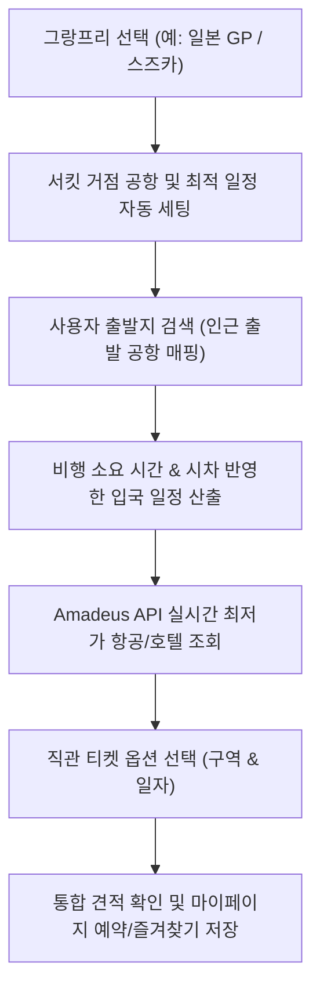

# 🏁 F1 Trip Planner (My F1)

> **F1 공식 레이스 캘린더 기반 항공권 · 숙박 · 직관 티켓 원스톱 통합 예약 플랫폼**

---

### 1. 아이템, 문제인식 | 접근 방식 | 어떤 단계를 거치게 되었는지

* **기존 문제 인식**
  * F1(포뮬러 1)은 매년 전 세계 20개국 이상의 서킷을 순회하는 메가 스포츠 이벤트로, 직관 팬들은 **항공, 호텔, 서킷 티켓, 레이스 일정**을 각각 개별 플랫폼(스카이스캐너, 아고다, 공식 F1 티켓팅 등)에서 일일이 대조하며 예약해야 하는 번거로움이 있었습니다.
  * 특히 서킷 개최 국가와 출발지 간의 **장거리 비행 소요 시간(10~15시간 이상)과 시차**를 고려하지 않고 경기 당일에 맞춰 일정을 예약할 경우, 현지에 도착했을 때 이미 세션(연습 주행/예선)이 종료되어 있는 치명적인 일정 오류가 발생했습니다.
  * 서킷 인근 거점 공항 정보와 숙소 위치가 직관 서킷과 멀리 떨어져 현지 교통편 낭비가 발생하는 문제가 있었습니다.

* **접근 방식**
  * **OpenF1 API 기반 실시간 레이스 캘린더 연동**: 공식 그랑프리 일정(연습/예선/결승) 및 서킷 위치 데이터를 중앙 집중화하여 제공.
  * **Amadeus API를 통한 항공 및 호텔 실시간 최저가 탐색**: 선택한 그랑프리 서킷의 IATA 거점 공항과 인근 숙소를 자동으로 매핑하고, 실시간 항공권/숙박 최저가 견적을 단일 대시보드에서 산출.
  * **시차 및 비행 시간을 감안한 스마트 스케줄러**: 경기 시작일에 종속되지 않고 글로벌 시차와 장거리 비행시간을 고려한 유연한 출발일/출발지 공항 자동 매핑 및 왕복/편도 정밀 견적 엔진 구현.
  * **서킷 직관 옵션 통합**: 일반 관람석(WEST AREA)부터 VIP 패독(PADDOCK CLUB), 일자별(1일차/2일차/풀 세션) 티켓 옵션을 한곳에서 조합하는 통합 패키지 시스템 기획.

* **어떤 단계를 거치게 되었는지**
  1. **요구사항 분석 & 여행 API 벤치마킹**: OpenF1 레이스 데이터 및 글로벌 여행 유통 GDS인 Amadeus API 연동 가능성 검증
  2. **Spring Boot 백엔드 아키텍처 구축**: 경기 일정 동기화, 외부 API 연동 클라이언트, 예약 데이터 DTO 및 RESTful API 설계
  3. **React & Tailwind CSS 프론트엔드 개발**: F1 감성의 다크 테마 반응형 웹 UI 및 통합 여행 일정 검색 화면 구현
  4. **2차 고도화 및 사용성 개선**: 회원 관리(로그인 유지, 마이페이지 즐겨찾기), 출발지 인근 공항 자동 추천, 편도/왕복 가격 정합성 보정, 실시간 최저가 갱신 엔진 구축

---

### 2. 기간

* **2026.02 ~ 2026.04** *(실제 프로젝트 일정에 맞추어 조정 가능)*

---

### 3. 역할

* **1인 개발 (풀스택 개발)**
  * Spring Boot 기반 백엔드 서비스 아키텍처 설계 및 구현 (Java 17, Spring Data JPA, MySQL)
  * OpenF1 API 및 Amadeus Travel API 비즈니스 연동 로직 개발
  * React 및 Tailwind CSS 기반 모던 다크 테마 UI/UX 개발
  * 회원 인증/인가, 세션 상태 유지, 마이페이지 예약/즐겨찾기 기능 구현

---

### 4. 기여, 기술적 어려움을 어떻게 해결하였으며, 이때 본인의 기여도

* **글로벌 시차 및 장거리 비행시간을 고려한 동적 일정 스케줄러 알고리즘 개선**
  * **문제**: 초기에는 선택한 그랑프리 시작일에 맞춰 출발일이 제한되어 있어, 미국 로스앤젤레스에서 일본 스즈카 GP로 이동하는 등의 장거리 비행(14시간 소요 + 시차 발생) 시 현지에 경기 종료 후 도착하게 되는 치명적인 결함이 존재했습니다.
  * **해결**: 출발 날짜 강제 제한을 해제하고, 출발지와 목적지 서킷 국가 간의 예상 비행 시간 및 시차를 계산하여 경기 시작 1~2일 전 여유 있는 입국이 가능하도록 유연한 날짜 선택 엔진으로 전면 개편했습니다.

* **Amadeus API 항공권/숙소 견적 정합성 확보 및 실시간 최저가 갱신 엔진 구현**
  * **문제**: 왕복(Round-trip)과 편도(One-way) 검색 시 동일한 요금이 표기되거나, 항공사 정보 및 상세 옵션(항공편명, 호텔 명칭)이 누락되어 사용자 신뢰도가 저하되는 문제가 있었습니다.
  * **해결**: 편도/왕복 쿼리 파라미터 분기 로직을 정밀화하고, Amadeus 응답 JSON에서 항공사 코드(Airline Code)를 항공사 정식 명칭과 매핑하여 UI에 노출했습니다. 또한 '최저가 갱신' 버튼을 통해 캐시된 데이터가 아닌 실시간 GDS 최저가 데이터를 재동기화하는 파이프라인을 구축했습니다.

* **출발지 기반 인근 공항 자동 추천 및 서킷 거점 IATA 공항 매핑**
  * 사용자가 본인의 거주 도시나 지역명을 검색하면 가장 가까운 국제선 출발 공항(예: 서울/인천 ICN, 부산/김해 PUS 등)을 자동으로 매핑하는 위치 기반 출발지 지정 로직을 구현했습니다.
  * 세계 20여 개 이상의 F1 서킷별 최적 도착 IATA 공항(예: 스즈카 서킷 ➔ 나고야 센트레아 NGO 공항) 메타데이터를 정규화하여 사용자의 수동 입력 단계를 획기적으로 단축했습니다.

* **인증 상태 지속성(Persistence) 및 세션 동기화 결함 해결**
  * 페이지 새로고침 시 로그인 인증 토큰이 유실되어 헤더의 버튼 상태(로그인/로그아웃)가 불일치하던 이슈를 LocalStorage 토큰 보관 및 React Context 기반 인증 동기화 로직으로 해결했습니다.

* **서킷 직관 좌석 구역(Zone) 및 세션별 옵션 모델링**
  * 스즈카 서킷 기준 West Area, Grandstand, Paddock Club 등 좌석 등급과 1일차/2일차/전일권 패스를 세분화하여 항공+숙소+티켓을 하나의 장바구니/예약 번호로 묶는 확장성 있는 DTO 구조를 설계했습니다.

---

### 5. 시스템 아키텍처 & 예약 플로우

#### 🏗️ System Architecture
```
┌─────────────────────────────────────────────────────────────┐
│                    사용자 (Web Browser)                     │
└──────────────────────────────┬──────────────────────────────┘
                               │ HTTP / JSON (Axios)
                               ▼
┌─────────────────────────────────────────────────────────────┐
│                  Frontend (React + Tailwind CSS)            │
│  - F1 일정 탐색 / 항공·숙박·티켓 견적 / 마이페이지 즐겨찾기 │
└──────────────────────────────┬──────────────────────────────┘
                               │ RESTful API
                               ▼
┌─────────────────────────────────────────────────────────────┐
│                  Backend (Spring Boot 3.2.0)                │
│  - TravelController / ScheduleService / AmadeusService      │
│  - JPA Repository & MySQL Database                          │
└──────────────┬──────────────────────────────┬───────────────┘
               │                              │
               ▼ REST API                     ▼ REST API (OAuth 2.0)
┌──────────────────────────────┐  ┌───────────────────────────┐
│         OpenF1 API           │  │     Amadeus Travel API    │
│ (2026 시즌 레이스 캘린더)    │  │ (실시간 항공권 / 호텔 최저가)│
└──────────────────────────────┘  └───────────────────────────┘
```

#### 🔄 Travel Booking Flow


---

### 🛠 Tech Stack

| 영역 | 사용 기술 |
|:---|:---|
| **Backend** | Java 17, Spring Boot 3.2.0, Spring Data JPA, Lombok, Gradle |
| **Database** | MySQL |
| **External APIs** | OpenF1 API (레이스 일정), Amadeus Self-Service API (항공/호텔) |
| **Frontend** | React 18.2.0, Tailwind CSS 3.3.6, Axios, JavaScript |
| **Tools** | IntelliJ IDEA, VS Code, Git, GitHub |
